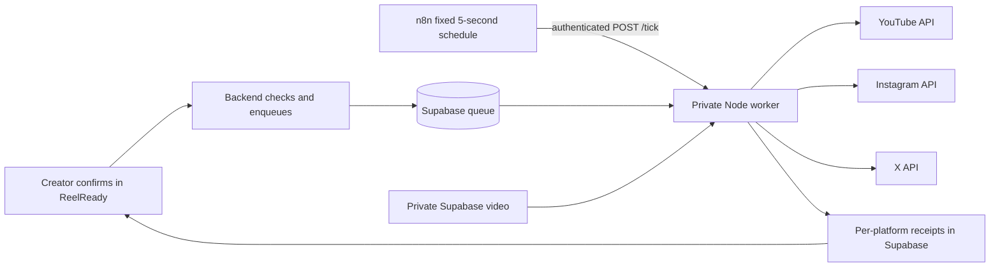

# Self-hosted n8n publishing coordinator

The user has now selected a managed-provider webhook workflow instead of this native scheduler-only path. See [MANAGED-N8N-PUBLISHING.md](MANAGED-N8N-PUBLISHING.md) for the current configuration. This document describes the retained native option.

ReelReady can now use a self-hosted n8n workflow to drive publishing. Upload-Post is not used. This replaces the autonomous publication loop, **not** the official platforms' OAuth/API requirements. The tested, encrypted account connections and native upload adapters stay inside the private publishing worker.



## What n8n does

The fixed workflow in `automation/n8n/publish-workflow.json` calls the private worker every five seconds. The database decides which confirmed jobs are due and atomically leases them. Each tick advances a job through its platform upload/processing stages, then records checkpoints and the next permitted attempt time. A platform response may take longer than five seconds; concurrent triggers cannot start a second executor in the same worker. Database leases also protect multiple workers. This is best-effort scheduling, not a promise to publish at an exact second.

`PUBLISH_EXECUTOR=n8n` disables the publication loop in `scripts/media-worker.ts`; FFmpeg's media queue still runs. `native` is an explicit rollback option and is the compatibility default for existing installations that have no setting. There is no automatic fallback executor if n8n stops: approved jobs remain saved until it returns. The browser polls stored receipts and does not execute publication. Explicit failed-only retries, account binding, token refresh, expiry checks, uncertainty handling and final confirmation remain intact.

The bridge accepts only an empty authenticated `POST /tick`, never user-selected job IDs, media URLs, account IDs or tokens. n8n holds only its own encrypted bridge credential. It receives `{claimed, demo}` or a sanitized operational error; no video, signed media URL, captions or social credentials pass through its execution history. Successful operational results are retained for up to 24 hours so n8n can report completed runs reliably; error/manual execution payload saving remains disabled. A no-save setting left records stuck as running on the tested n8n version; retaining these non-sensitive success results resolves the observed status issue. `DEMO_MODE=true` prevents any real publication. Only exact `false`, valid official connections and an approved queue job allow real delivery.

## Local setup

Requirements: Node 22, Docker Compose, running local Supabase and the existing migrations.

```sh
npm run n8n:setup
npm run dev:all
```

If ReelReady is already running, stop its existing `dev:all` process gracefully and restart it once. Do not start two workers on port 3010.

The setup script uses a pinned n8n 2.44.6 image/digest, creates a dedicated persistent Docker volume, securely generates the bridge secret and n8n encryption key, imports only ReelReady's credential/workflow, publishes that workflow and selects n8n in `.env.development.local`. It does not reset existing Supabase or n8n data. The two stable ReelReady import IDs are reserved for this workflow/credential; re-running setup updates those two records. Plaintext bootstrap credentials are mode 600, excluded from git/images, streamed into the container and removed after import. No credentials appear in command arguments or output. The existing `DEMO_MODE` value is preserved; setup itself does not enqueue a post.

- Creator application: `http://127.0.0.1:3000` — unchanged, no visible login or PIN.
- n8n operator editor: `http://127.0.0.1:5678` — local-only admin interface. Set up your own operator account before using the editor; creators never need access to it. The pre-published scheduler does not require creators to log into n8n.
- Private publisher: port 3010. Setup binds it to `0.0.0.0` so local Docker can reach the host; it requires a 32+ character secret. Never expose this port publicly; restrict it with the host firewall/private network.
- `npm run n8n:start`: restart the existing persistent n8n container.
- `npm run n8n:stop`: stop it without deleting data/volumes.
- `GET /api/health`: `publishingExecutor: {executor: "n8n", status: "online" | "offline"}`.
- `npm run check:env -- --local`: configuration and executor status, never credentials.

The n8n status requires a fresh successful authenticated-trigger heartbeat, not merely a running Docker container. n8n heartbeats are excluded from the FFmpeg worker status. The public health response never exposes bridge addresses or secrets. An online executor is not evidence that platform apps are configured or connected.

## Production with Vercel

Vercel serves Next.js and the existing OAuth callbacks. Hosted Supabase holds private media and durable jobs. Run n8n and the Node/FFmpeg publishing worker on long-lived compute. Keep the editor behind operator authentication and the bridge on a private network. The included Compose file is **local-only**: loopback editor binding and `N8N_SECURE_COOKIE=false` must be replaced by your production HTTPS/proxy setup. Keep the n8n workflow URL on the worker's internal service address instead of `host.docker.internal`.

Server and worker need `PUBLISH_EXECUTOR=n8n`, matching pool/Supabase/encryption keys and the existing official Google, Meta and X app credentials. Only the private worker needs to listen on `N8N_PUBLISHER_HOST` / `N8N_PUBLISHER_PORT`; its `N8N_PUBLISHER_SECRET` must match the n8n Header Auth credential. Never share social tokens or a Supabase service-role key with n8n. Keep n8n's own encryption key/volume backed up. Use fresh HTTPS callback registrations for your public `APP_URL`, and verify real consent/post visibility separately. No production deployment or real social post was performed in this change.

## Cost and licensing

Self-hosted n8n removes the need for a paid publishing intermediary; it does not make hosting, video storage/egress, AI speech or platform API access free or unlimited. Existing spend/rate/upload/queue limits remain. OAuth permissions, app review, eligible Instagram accounts and platform quotas still apply.

The current n8n FAQ permits fixed backend automations that users can trigger and connect accounts to, provided they cannot build or modify the workflows. This implementation keeps the workflow editor operator-only. It does not expose a customer workflow builder. Consult the actual license and current FAQ if that product boundary changes; do not promise unrestricted free redistribution or embedded workflow building.

Primary references:

- [n8n license FAQ](https://docs.n8n.io/n8n-community-license/community-license/license-faq.md)
- [Sustainable Use License](https://github.com/n8n-io/n8n/blob/master/LICENSE.md)
- [Schedule Trigger](https://docs.n8n.io/integrations/builtin/core-nodes/n8n-nodes-base.scheduletrigger)
- [Server CLI imports and workflow publication](https://docs.n8n.io/deploy/host-n8n/configure-n8n/use-the-command-line.md)
- [Docker hosting](https://docs.n8n.io/deploy/host-n8n/install-options/install-with-docker.md)
