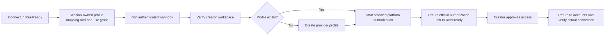

# Account connection and video publishing through n8n

ReelReady now has two main application-connected n8n workflows. Existing status and health workflows support delivery. All run in the same local self-hosted n8n instance; creators use ReelReady's existing account and studio screens.

## 1. Connect creator accounts

Published workflow: `ReelReadyProviderConnectV1`, webhook `POST /webhook/reelready-provider-connect`.

`POST /api/connect/{youtube,instagram,x}` now invokes this n8n workflow in managed mode. The backend verifies the creator's anonymous Supabase session, reserves the immutable owner → profile mapping, and creates a two-minute random grant stored only as a hash. The existing service-only OAuth-state table holds these records with a separate operation marker; native OAuth records are not reused or changed. No migration is required for this extension.

The n8n workflow calls the private worker's `/connect-authorize` endpoint. It atomically consumes the grant and derives the profile, selected platform and return URL from owned server records. A read-only provider check determines whether creation is needed. n8n creates only a missing profile, handles accepted creation/conflict responses, requests the provider's platform authorization URL and returns that URL to the current application. Creator-supplied profile names/return URLs are ignored. Expired, replayed or malformed grants stop the flow.

The creator still approves the official platform's authorization screen. The provider completes OAuth/token storage and returns them to ReelReady. The Accounts page confirms actual owned profile state through a server check; query-string success flags cannot connect an account. Passwords and platform tokens are not entered into the workflow or app. Profile capacity errors do not assign another creator's account or silently fall back to a shared profile.

## 2. Publish approved video

Published workflow: `ReelReadyProviderPublisherV1`, webhook `POST /webhook/reelready-provider-publish`.

The existing publishing workflow remains connected: creator confirmation → durable owned job → due-time dispatch → n8n → one-use publication authorization → provider upload → persisted status/links. The payload includes the approved video's short-lived, job-bound private media ticket, selected destinations and the platform-specific copy supplied by ReelReady:

- YouTube title and description.
- Instagram caption.
- X caption.
- Selected platforms and the existing synthetic-media disclosure flag.

n8n submits these through its HTTP Request node; n8n downloads the approved file from the authenticated private worker and posts its bytes to the provider, which delivers it to the connected accounts. ReelReady uploads originals directly to private Supabase Storage rather than passing a large video through its web API. n8n does not regenerate or overwrite the creator's approved captions. Duplicate clicks/webhooks and uncertain commits retain the existing protections. The supporting status workflow retrieves per-platform results for the app.

## Authentication and local operation

Application → n8n calls use short-lived HS256 JWTs. n8n → private worker calls use the encrypted bridge Header Auth credential. Provider credentials remain server-only/encrypted in n8n. The bridge accepts bounded JSON and only returns canonical server-derived data. Account grants are single-use and expire in two minutes; publishing grants remain separately scoped and single-use.

Run `npm run n8n:setup -- --provider` to import/publish the account, publishing, status and health workflows. Restart an existing `npm run dev:all` process so the worker serves the new account-authorization endpoint. No new environment variables are required beyond the existing managed-provider setup. The application remains at `http://127.0.0.1:3000`, and the operator editor is at `http://127.0.0.1:5678`.

`npm run verify:n8n:connect` tests the actual n8n account workflow with a local mock server and fake credentials, covering all three platform links, existing/new profiles, capacity rejection and grant replay. It unpublishes its reserved verification workflow afterward. `npm run verify:n8n` covers the existing publishing workflow. Neither verification contacts real social/provider endpoints or modifies real accounts. Backend tests separately exercise actual local Supabase grant ownership/expiry/atomic consumption and the application-to-webhook call.

Managed n8n publishing now defaults to private binary transfer, so local Supabase media is supported without a public storage URL. The native and legacy URL adapters still enforce their public-media requirements. Additional creators need available provider profile slots. The existing provider account had two occupied slots at the last read-only check. No real profile creation, account approval, social post, hosted migration or public deployment was performed in this extension.

## Verification results

Both main workflows were verified as published in the signed-in local n8n workspace. The new account workflow passed actual n8n tests against local mock APIs for existing/new profiles, YouTube/Instagram/X links, capacity failure and replay rejection. Backend: 74 passed; media: 8 passed; browser: 14 passed (96 automated tests total). Lint, typecheck and production build passed. Production client bundles contained no server secrets or provider name, and container logs contained no current bridge/provider keys. No creator account or real social post was changed by verification.
